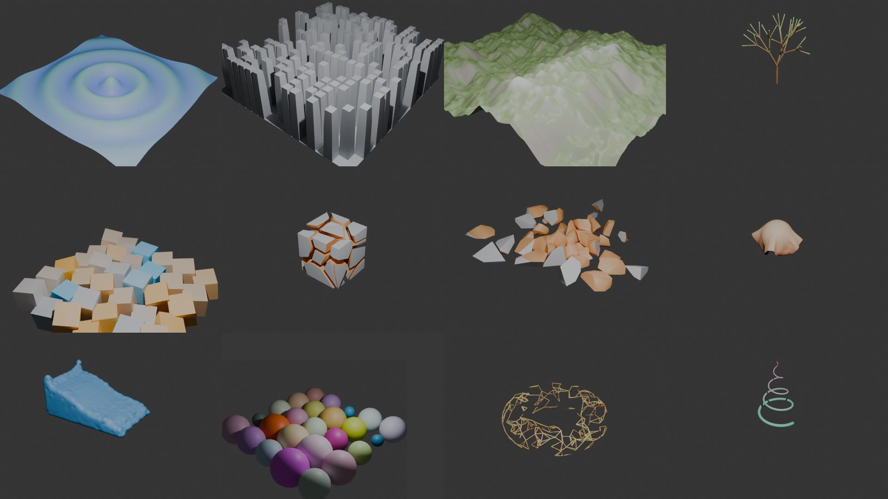

# Blendini

**Houdini-style procedural SOP networks for Blender, with a VEX wrangle.**



*The bundled example networks, rendered with Cycles: VEX ripple, PolyExtrude city, eroded
heightfield, L-system, For-Each, Voronoi fracture, RBD (Bullet), Vellum-style cloth, PBF fluid
meshed with OpenVDB, packed instances, a nearpoints "plexus" and a curve built in a Detail
Wrangle.*

Blendini is an open-source take on Houdini's geometry context. It uses Blender as the
host and backend. You build a network of SOP nodes in a node editor. The node with the
**display flag** cooks into a Blender object. The **Point Wrangle** runs real (subset)
VEX code over every point in parallel.

It ships as a core add-on in this Blender fork (`scripts/addons_core/blendini`), together
with a *Blendini* application template.

## Installing into a regular Blender

This fork ships Blendini as a core add-on, but it is pure Python + numpy and also works in a
stock Blender (4.2+, developed against 5.2):

```sh
cd scripts/addons_core/blendini
blender --command extension build      # creates blendini-0.1.0.zip
```

Then use *Preferences → Get Extensions → Install from Disk* with the zip.

## Quick start

**Fastest:** *File → New → Blendini* (or pick Blendini on the splash screen). This
application template enables the add-on, starts with an empty scene and a `geo1` network,
and arranges a Houdini-style layout.

Or step by step:

1. Enable **Blendini** in *Preferences → Add-ons*.
2. In the 3D viewport choose *Add → Blendini Geometry*. This creates `geo1` (an object
   plus its SOP network, like `/obj/geo1`) and opens the network in a node editor.
3. Or use *Add → Blendini Examples* to build fourteen example networks: ripple, scatter and
   copy, plexus, city, particles, for-each, L-system tree, Vellum cloth, fracture, RBD
   fracture, eroded terrain, fluid dam break, VOP displacement and spiral. Press play for the simulations.
4. In the node editor:
   - **Tab**: Houdini-style TAB menu (start typing to search). With a node selected, the new
     node is wired to its output and takes over the display flag, like Houdini.
   - **R**: set the display flag on the active node.
   - **M**: bypass (Blender's mute, shown as a pass-through).
   - Each node has **display**, **template** (ghosted wireframe guide) and **bypass** flag
     buttons. As in Houdini, the active flags are drawn as colored bars on the node edges:
     blue for display, pink for template, yellow for bypass, red for errors. The node type is
     shown under each node.
   - **N** sidebar → **Parameters** tab: the parameter pane and the geometry info
     (point and primitive counts, attributes, groups, cook time, `printf` output), plus
     *Save Geometry to Disk* (.obj) and **Bake** (freeze the result as a Blender mesh, or one
     Blender object per piece).
   - *Blendini* tab → *Apply Houdini-like Theme* for the grey gradient viewport and a dark
     network editor. *Houdini-like Layout* splits the screen into viewport + network +
     spreadsheet.
   - **N** sidebar → **Spreadsheet** tab: Houdini's Geometry Spreadsheet for the *active*
     node (points / vertices / primitives / detail, attributes and groups).
   - 3D viewport sidebar → *Blendini* tab: a Houdini-style **Create shelf** (Box, Sphere,
     Tube, Torus, Grid, ... each makes a new geometry object with that SOP inside).
   - Viewport display of point numbers, primitive numbers and normals: the *Blendini* tab of
     the node editor, or the 3D viewport's sidebar. That sidebar also has a **Visualize
     Attribute** field, which shows any point or primitive attribute as false color.
5. On a wrangle, click **Edit**. The VEX code opens in a Text Editor, with C-like syntax
   highlighting, and the network **recooks live as you type**. A status bar at the bottom of
   the editor shows syntax and runtime errors, with line numbers, or the cook time. The
   **+** button creates spare parameters for every `ch("name")` call, like Houdini's
   "create spare parameters" button. The presets menu holds ready-made snippets (noise
   displacement, color by height, random pscale/orient, plexus lines, curl noise, twist,
   ...). The **?** button lists every supported VEX function.

Output objects get a *Blendini Cd* material, so renders show `Cd` (or per-instance `Cd`)
like Houdini does, with grey as the fallback. Missing attributes are filled with Houdini's
defaults, e.g. white for `Cd` and 1 for `pscale`.

Blender is Z-up and Houdini is Y-up. Output objects are rotated 90° around X so
`@P.y` stays "up" in your VEX. Object Merge converts the other way.

## Your first network (the classic Houdini warm-up)

1. *Add → Blendini Geometry* (or *File → New → Blendini*). Delete the starter nodes if you
   like.
2. **Tab** → type `grid` → Enter. Set *Rows/Columns* to 50.
3. With the grid selected: **Tab** → `mountain`. It is wired in and gets the display flag.
4. **Tab** → `scatter` (1000 points), then **Tab** → `point wrangle`. Pick *Random pscale
   and orient* from the presets menu (or type your own VEX).
5. Add a **Box** off to the side, then **Tab** → `copy to points`. Wire the box into the
   first input and the wrangle into the second. Press **R** on it.
6. Tweak the spare parameters on the wrangle, or press **Edit** and change the VEX: the
   viewport updates as you type. Press **I** over a field to keyframe it, or type
   `#frame * 0.1` to drive it like a `$F` expression.

## Nodes

| Category  | SOPs |
|-----------|------|
| Primitive | Box, Grid, Sphere (UV / icosahedron), Tube, Torus, Circle, Line, Platonic Solids, Bound, Font\*, L-System |
| Manipulate| Transform, Primitive, Mirror, Bend (bend / twist / taper), Point Deform, Match Size, **Edit** (move points in Blender's Edit Mode, stored as offsets), Mountain, Point Jitter, Peak, Smooth, Ray\* |
| Simulation| **Solver (VEX)** (SOP Solver), **Vellum Cloth (PBD)** (stretch/bend constraints, pins, ground, colliders), **RBD Bullet Solver\*** (Blender's rigid bodies in a private scene), **Fluid Solver (PBF)** (experimental particle fluid in a box) |
| Polygon   | **Voronoi Fracture\***, Particle Fluid Surface\* (OpenVDB meshing), Add, Clean, Ends, Fuse, Facet, Divide, Reverse, PolyExtrude, PolyWire, Sweep, Resample, Carve, Convert Line, PolyPath, Subdivide\*, PolyBevel\*, Boolean\*, Remesh\*, PolyReduce\*, Clip\* |
| Attribute | Attribute Create / Delete / Rename / Copy / Promote / Randomize / Noise / Transfer / Blur, Name, Attribute from Map\*, Color, Normal, Connectivity, Measure, UV Texture, UV Unwrap\* (Smart UV Project / Unwrap / Cube), PolyFrame, Trail (velocity, also feeds Blender motion blur) |
| Terrain   | HeightField, HeightField Noise (fBm / ridged), HeightField Erode (thermal + flow-based hydraulic) |
| Group     | Group Create (pattern / bounding box / normal / random / `@expression`), Group Combine, Group Promote, Blast |
| Copy      | Copy to Points (orient, N/up, pscale, scale, piece variants, **Pack and Instance**), Pack, Unpack, Assemble, Copy and Transform, Scatter, Points from Volume\* |
| VEX       | Attribute Wrangle (run over points / prims / vertices / detail / numbers), **Point Wrangle**, Primitive Wrangle, Detail Wrangle, **Attribute VOP** (visual VEX: Globals, Bind, Parameter, math, vector, noise and color VOPs; dive in with I; shows the generated VEX) |
| Utility   | File (.obj), **Subnetwork** + Subnet Input (dive in with I, up with U), Merge (multi-input), Switch, Null, Output, Sort, Time Shift, **Block Begin / Block End (For-Each pieces or feedback)** |
| Blender   | Object Merge (meshes and curves, several objects / wildcards), Solidify\*, **Blender Modifier\*** (any modifier, including Geometry Nodes groups) |

\* These use Blender as the backend. The geometry passes through a real Blender modifier,
`bmesh` operator, BVH tree, Bullet rigid body world or OpenVDB Geometry Nodes, and comes
back with its attributes.

**Packed geometry**: when *Pack and Instance* is on, Copy to Points outputs one point per copy
that references the source geometry, the same as Houdini's packed primitives. Transform,
Merge and so on work on the packed points. On output, the copies become real Blender
instances through a generated Geometry Nodes modifier, so millions of copies stay cheap.
Per-copy attributes such as `Cd` are available to materials through the
*Attribute (Instancer)* node. *Unpack* converts packed points back into real geometry.

Group fields accept Houdini patterns: group names, `0-10 15`, `!name`, and VEX
expressions such as `@P.y > 0` or `@ptnum % 2 == 0`.

## VEX

The wrangle doesn't loop over points in Python. The snippet is parsed into an AST, then
run **SIMD style**: every value is a numpy array with one lane per element. `if`/`else`,
loops, `break`/`continue` and `return` work by masking lanes, much like a GPU, so
typical wrangles run at numpy speed. For example, a 490k point ripple wrangle cooks in
about 0.8 s, and 10k points with `nearpoints` and `noise` in about 0.2 s.

Supported language:

- Types: `int float vector2 vector vector4 matrix2 matrix3 matrix string` and arrays (`int[]` …).
- `@` bindings with prefixes (`f@ i@ v@ p@ u@ s@ 2@ 3@ 4@ i[]@` …) and known names
  (`@P @N @Cd @v @orient @pscale @id @name` …).
- `@ptnum @primnum @numpt @numprim @elemnum @numelem @Time @Frame @TimeInc`,
  `@group_name` and `@opinput1_P`.
- Operators with VEX semantics: integer division, `vector * matrix`, `.xyz`/`.zyx`
  swizzles, component and array indexing, `+= -= *= /= %=`, `++`/`--`, ternary,
  `&& || !`, and C-style or function-style casts.
- `if/else`, `for`, `while`, `do/while`, `foreach (int i; int x; arr)`, `break`,
  `continue`, `return`.
- User functions with VEX's **pass-by-reference** parameters, recursion and early `return`.
- Return-type overloading from context: `vector r = rand(@ptnum);` and
  `vector n = noise(@P);` return vectors.

Builtins (partial list):

- Math: `sin cos tan asin acos atan atan2 sqrt pow exp log abs sign floor ceil frac round
  min max clamp fit fit01 fit10 fit11 efit lerp smooth avg sum`.
- Color and textures: `hsvtorgb rgbtohsv colormap texture` (Blender images by name or path).
- Vectors: `length length2 distance distance2 normalize dot cross reflect set getcomp`.
- Matrices and quaternions: `ident rotate scale translate transpose invert determinant
  maketransform lookat dihedral quaternion qconvert qrotate qmultiply slerp eulertoquaternion`.
- Random: `rand random noise snoise onoise curlnoise sample_direction_uniform`.
- Geometry reads: `point prim vertex detail npoints nprims nvertices primpoints pointprims
  primpoint primvertexcount neighbours neighbourcount nearpoint nearpoints
  getbbox getbbox_min/max/center/size relbbox inpointgroup inprimgroup haspointattrib
  vertexpoint vertexprim idtopoint findattribval primarea primintrinsic attrib
  npointsgroup nprimitivesgroup`.
- Geometry writes: `addpoint addprim addvertex removepoint removeprim setpointattrib
  setprimattrib setvertexattrib setdetailattrib setattrib addpointattrib addprimattrib
  adddetailattrib setpointgroup setprimgroup`. The `"add"`,
  `"min"`, `"max"` and `"mult"` modes are supported.
- Arrays: `len append push pop insert removeindex resize find sort argsort reverse array
  isvalidindex`.
- Strings: `sprintf printf itoa atof atoi strlen concat startswith endswith toupper tolower
  split join strip replace`.
- Channels: `ch chf chi chv chs chramp`, backed by spare parameters. Ramps are curve widgets.
- Point clouds: `pcopen pcfilter pcnumfound pcclose pcfind`.
- Closest point queries: `xyzdist` (with `prim`/`uv` output arguments), `primuv`, `minpos`, using Blender's BVH tree.
- Constants from `math.h`: `M_PI`, `M_TWO_PI`, `M_E`, `FLT_MAX` and others.

As in Houdini, reads with `point()` etc. see the **input** geometry. `@` writes and
geometry edits are applied after the snippet finishes.

## Example: ripple Point Wrangle

```c
float d = length(@P);
float freq = ch("freq");
float amp = ch("amp");
@P.y = sin(d * freq - @Time * 4) * amp * exp(-d * 0.3);
@Cd = set(0.2, 0.5 + @P.y, 1.0 - @P.y);
```

## Architecture

```
blendini/
  core/geometry.py   points / prims / vertices / detail attributes + groups (numpy)
  core/noise.py      vectorized Perlin noise, curl noise, hash random
  vex/parser.py      lexer + recursive descent parser for VEX
  vex/interp.py      SIMD masked interpreter
  vex/builtins.py    VEX function library
  vex/wrangle.py     binds attributes, runs the snippet, applies deferred geometry edits
  sops/              declarative SOP definitions (no Blender dependency, except blender_ops.py)
  bl/                Blender integration: node tree, cooking/cache, mesh conversion, UI
  tests/             unit tests runnable without Blender
```

Cooking is signature-based. Each node result is cached with a hash of its parameters,
its inputs' signatures and, when time dependent, the frame. Only nodes whose upstream
changed recook, like Houdini's dirty propagation.

Parameters can be keyframed (**I** over a field) or given a driver expression, which plays
the role of a Houdini parameter expression. Type `#frame * 0.5` or `#sin(frame / 10) * 2`
into any field. Blendini evaluates these itself, because Blender doesn't evaluate
animation on custom node trees. Driver expressions run through the VEX interpreter with
`frame`, `time` and `fps` defined, so they are safe to open from any file.

Run the tests (no Blender required, only numpy):

```sh
cd scripts/addons_core
python -m unittest blendini.tests.test_blendini
```

## Security

Opening a .blend file with Blendini networks never runs Python from the file. VEX is
interpreted by Blendini itself and can only read and write geometry. That's also why
there is no Python SOP.

## Not done yet (ideas)

NURBS and Bézier primitives, volumes/VDB, a full DOP context (constraints, FLIP meshing, Pyro), more VOP types, VEX `struct`s
and function-like macros, viewport handles/states, and a multi-line code editor inside the parameter
pane. Today the code is edited in Blender's Text Editor, which recooks live.
